<a href="https://angelsaikia.com">
  
</a>

At [Reelax](https://getreelax.com), a creator-brand marketplace, I'm the main engineer on its React Native creator app, lead the frontend of its new Next.js brands app, and have shipped across six production apps. I also built the backend for [Twik](https://twik.app), a voice keyboard that passed half a million accounts in ten weeks, and work across its Android, iOS and macOS apps.

<p>
  <a href="https://angelsaikia.com"></a>
  <a href="https://angelsaikia.com/Angel%20Saikia%20-%20CV.pdf"></a>
  <a href="https://linkedin.com/in/angel-saikia"></a>
  <a href="mailto:angelsaikia.dev@gmail.com"></a>
</p>



<br />


<table>
  <tr>
    <td width="50%"><a href="https://getreelax.com"></a></td>
    <td width="50%"><a href="https://brands.getreelax.com"></a></td>
  </tr>
  <tr>
    <td><sub><a href="https://apps.apple.com/in/app/reelax-influencer-app/id6464481879">App Store</a> · <a href="https://play.google.com/store/apps/details?id=com.reelax.influencer">Google Play</a> · <a href="https://spotlyt.in">Spotlyt</a> · <a href="https://angelsaikia.com/notes/react-native-0-82-migration">Read: the 0.82 migration</a></sub></td>
    <td><sub><a href="https://brands.getreelax.com">brands.getreelax.com</a> · <a href="https://angelsaikia.com/notes/server-actions-without-leaking-payloads">Read: the Brands V2 data layer</a></sub></td>
  </tr>
  <tr>
    <td width="50%"><a href="https://twik.app"></a></td>
    <td width="50%"><a href="https://github.com/Dhunu/gitOS"></a></td>
  </tr>
  <tr>
    <td><sub><a href="https://apps.apple.com/us/app/twik-ai-voice-keyboard/id6756659600">App Store</a> · <a href="https://play.google.com/store/apps/details?id=com.twikapp.android">Google Play</a> · <a href="https://angelsaikia.com/notes/twik-launch-week">Read: launch week</a></sub></td>
    <td><sub><a href="https://github.com/Dhunu/gitOS">Source</a> · <a href="https://angelsaikia.com/notes/gitos-account-switching">Read: how the switching works</a></sub></td>
  </tr>
</table>


| | |
|:--|:--|
| `GitOS` | [Switching GitHub accounts without touching ~/.gitconfig](https://angelsaikia.com/notes/gitos-account-switching) |
| `Twik` | [What broke when 125k people signed up in a day](https://angelsaikia.com/notes/twik-launch-week) |
| `Next.js` | [Keeping API payloads out of the browser with Server Actions](https://angelsaikia.com/notes/server-actions-without-leaking-payloads) |
| `React Native` | [Notes from moving a production app to React Native 0.82](https://angelsaikia.com/notes/react-native-0-82-migration) |







<br />

<a href="mailto:angelsaikia.dev@gmail.com">
  
</a>

<details>
<summary><sub>Dev metrics, updated automatically</sub></summary>

<!--START_SECTION:waka-->


📊 **This Week I Spent My Time On** 

```text
🕑︎ Time Zone: Asia/Kolkata

💬 Programming Languages: 
TypeScript               4 hrs 47 mins       █████████████░░░░░░░░░░░░   51.32 % 
Markdown                 1 hr 17 mins        ███░░░░░░░░░░░░░░░░░░░░░░   13.88 % 
JSON                     45 mins             ██░░░░░░░░░░░░░░░░░░░░░░░   08.17 % 
Other                    39 mins             ██░░░░░░░░░░░░░░░░░░░░░░░   07.01 % 
JavaScript               33 mins             ██░░░░░░░░░░░░░░░░░░░░░░░   06.06 % 

🔥 Editors: 
Claude Code              8 hrs 46 mins       ████████████████████████░   94.01 % 
VS Code                  33 mins             █░░░░░░░░░░░░░░░░░░░░░░░░   05.99 % 
```

🤖 **AI Coding This Week** 

```text
⏱ AI Coding Time: 9 hrs 10 mins (98.35%)

✍️ 8,978 lines written by AI, 3 lines written by hand (99.97% AI-written)

🔤 4,765,957 Input Tokens, 1,142,631 Output Tokens

💵 $129.77 Estimated AI Cost This Week

🧠 19 AI Sessions, 100 AI Prompts

Opus                     9,660 lines         █████████████████████████   99.38 % 
Grok                     60 lines            ░░░░░░░░░░░░░░░░░░░░░░░░░   00.62 % 
Sonnet                   0 lines             ░░░░░░░░░░░░░░░░░░░░░░░░░   00.00 % 

🔎 AI Coding Insights:
🤖 AI-Driven — 99.97% of written lines came from AI
📚 Verbose Prompter — average 1,548 characters per prompt
🔁 Iterative Prompter — average 5 prompts per session
🚀 High AI Trust — 0.03% of changed lines were hand-edited
```


<!--END_SECTION:waka-->

</details>
